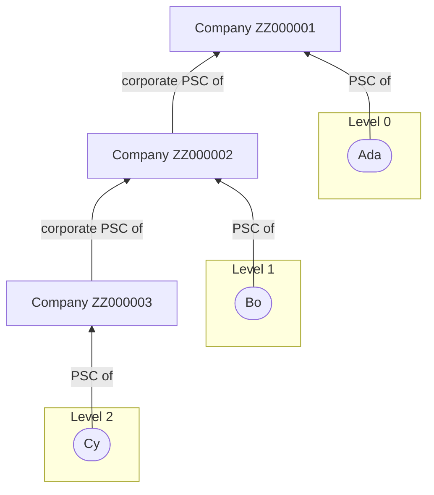

# Technical Exercise — Persons with Significant Control

This is a small, realistic piece of the work our data team does: take a raw public dataset, turn it into something an API can serve, and deploy it to Kubernetes. We care far more about how you think, how you check what your AI tools produce, and how you explain your decisions than about how much you produce. Please read the whole brief before you start.

## Ground rules

- **Spend no more than 3-4 hours.** We are not looking for a finished product. If you run out of time, stop and write down what you'd do next. 
- **Use AI tooling.** We work AI-natively (Claude Code) and we expect you to. We're interested in how you plan, direct and check that work, not in whether you can type it all by hand. Everything you submit is your own work, so review what the tools produce.
- **Show your working.** Keep the plans, prompts and any skills or agent instructions you create along the way. You don't need to share full session logs but you should demonstrate your use of AI.
- **Build only what we ask for.** A small, well scoped pipeline that works end to end, with tests, beats a bigger more complicated one that doesn't.

## Background

Kraken, our property data API, tells customers who is behind a company. This matters for property: many properties are owned by companies, and one corporate landlord can own hundreds of them, so the people behind a company are often the people behind those properties. The source is the Persons with Significant Control (PSC) register. Companies House publishes the whole register as a snapshot every week.

A PSC can be a person, or another company (a "corporate PSC"). When a company is controlled by another company, the people who actually control it are registered against that other company, or against a company further up the chain. To answer "who controls this company?", you have to follow the chain.

A couple of notes from the teams that asked for this:

> "Customers want to see the people behind a company, including the ones who control it through other companies, not just the names registered on the company itself."

> "We want this using one lookup per request. We don't want to walk the ownership chain at request time."

[`data/`](data/) holds a sample of the snapshot from 29 October 2026, in the format Companies House publishes it. See [`data/README.md`](data/README.md).

## The task

### Part 1: The pipeline

Build a pipeline that takes the raw snapshot and produces a dataset an API can serve for this endpoint:

```
GET /companies/{company_number}/persons-with-significant-control
```

For a company, the endpoint returns the people with significant control **now**, grouped by control level:

- **Level 0:** the people registered against the company itself.
- **Level 1:** the people registered against the companies that are corporate PSCs of that company.
- **Level 2:** the people registered against the corporate PSCs of those companies, and so on up the chain.

An example. A request for `ZZ000001` returns Ada at level 0, Bo at level 1 and Cy at level 2:



What we need:

1. The input is the file in `data/`, unchanged. Treat it as you would any third-party source.
2. The output should let an API answer the request above with one lookup by company number. The API does no other work. The exact shape of your output is up to you.
3. The pipeline checks the data. Bad data must not reach the output without anyone knowing, and you must be able to tell us what the checks found.
4. Tests for the parts of your code that matter.
5. Python and/or SQL. Everything else is your choice.
6. **You do not need to build the API** or the endpoint, just produce the data the API would use.

Everything else is up to you to decide: for example, what counts as a person, and what to do when a company chain can't be followed. Make a sensible call and say why.

### Part 2: Deploy it with Helm

[`kubernetes/helm/psc-pipeline/`](kubernetes/helm/psc-pipeline/) is a Helm chart for this pipeline. A teammate asked an AI agent for "a chart that runs the pipeline every week, with a Postgres database for the results", and merged what it produced without a review. Nobody has run it yet.

1. Change the chart so that it deploys your pipeline. It doesn't have to be exactly how you'd run it in production, but it must be correct: if we install it on a cluster, your pipeline must run and write its output. You don't need a cluster for this exercise, but a local one (for example [kind](https://kind.sigs.k8s.io/)) is a good way to check your work.
2. Review the chart as you would review that teammate's pull request. Put the review in `REVIEW.md`: what is wrong with the chart as you received it, how much each problem matters, and what you changed. Include the problems you chose not to fix, and say why.

### Production: write-up only

You don't need to build this. The full snapshot has about 16 million records (about 15 GB of JSON lines) and arrives every week. Our platform is GKE, BigQuery, Dataflow and GCS on Google Cloud with Elastic Search in GKE. In your notes, tell us how you would run this for real: where it would run, how it would scale, how you would know it had gone wrong, and what would change from what you built.

## Optional: only if you have time

You don't need to build these. If you have time, pick whichever interests you. If not, a sentence in your notes on how you'd approach it is just as good.

- **Serve it.** A small read-only API for the endpoint, on top of your output.
- **The reverse question.** Every company a person controls, directly or through other companies.
- **Next week.** How your pipeline would take next week's snapshot: what changes, and what happens to records that are no longer in it.

## What to hand back

The repository already has `NOTES.md`, `REVIEW.md` and `artifacts/` for you to fill in.

1. **A fork of this repository** with your work on a branch. Open a pull request from that branch **against the `main` branch of this repository**. Send us the link to the pull request.
2. [`NOTES.md`](NOTES.md), filled in. One page at most (about 500 words). Write it yourself, not with AI: we want your words. Keep its headings:
   - **What I built:** in a few sentences.
   - **Decisions:** the main decisions and trade-offs, and why you made them.
   - **How I checked it:** how you checked the data, the code, and what your AI tools produced.
   - **How I worked:** how you got from this brief to the work: how you planned, how you used AI, and where you stepped in.
   - **Production:** your answer to the write-up above.
   - **What I'd do next:** including where your solution might not work in production.
3. [**`REVIEW.md`**](REVIEW.md), filled in: your review of the chart from Part 2.
4. [**`artifacts/`**](artifacts/), with what you produced along the way: plans, specs, prompts, and any skills or agent instructions (for example a `CLAUDE.md`). You don't need to share full session logs, but the folder must show how you used AI. **Do remove any secrets**.
5. **How to run it:** fill in the "Running the solution" section of [`README.md`](README.md) with the exact commands to run your pipeline from a clean clone, to deploy it with your chart, and to look up one company in the output.

## What happens next

The next stage is a session where you talk us through your submission. We will ask about your decisions, how you found the task and what was difficult/straight forward.

## What we're looking for

- Sound decisions you can explain and defend.
- Evidence that you checked your work and your AI's work.
- A  pipeline that is transparent about data quality (it tells us what it dropped, fixed or could not follow).
- A chart we could install.
- Clear, short writing.

We are not looking for feature count, polish, or a perfect solution.

If anything's unclear, make a reasonable assumption, note it, and carry on. Good luck.
