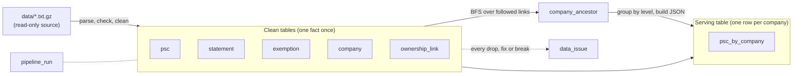
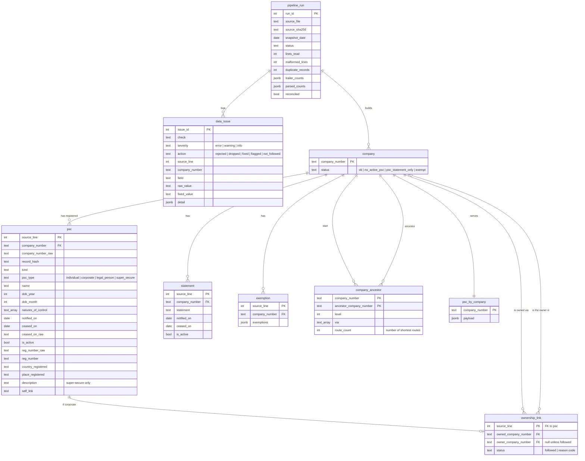

# Plan 01: Logical data model

- Status: **Draft v3, awaiting approval**
- Inputs: [spec 00](../specs/00-task-understanding.md), [spec 01 data profile](../specs/01-data-profile.md), ADRs [0001](../decisions/0001-traversal-bfs-in-python.md) to [0012](../decisions/0012-when-the-run-fails.md)
- Output of this step: `artifacts/specs/02-logical-data-model.md` (entities, keys, the payload contract, issue codes and worked examples). It contains no code and no DDL. The DDL comes in the implementation plan (plan 02).

Changes since v1 (2026-11-13), after the user's review:
- Personal data trimmed (ADR 0011): nationality, country of residence and name elements removed.
- ADRs added for every judgement call: person definition (0007), ceased records (0008), chain breaks (0009), duplicates and malformed records (0010). Loops are covered by 0001.
- Added a `company_ancestor` table (the BFS output), an ER diagram (section 3) and a worked example (section 5).

Changes since v2 (2026-11-13), after an external review that was checked against the data:
- **Several routes made simpler (ADR 0003):** each registration is listed at its company's lowest level. People aren't merged, there's no `other_levels`, and `psc_routes_by_company` is removed. `route_count` is now the number of shortest routes.
- **Legal persons** moved from `unfollowed` to a new `other_controllers` list (ADR 0007).
- **Normalisation:** `R` plus 7 digits accepted; prefix padding confirmed against the data; `jurisdiction_missing` added; every serving key must be reachable (ADRs 0005 and 0009).
- **"Now":** future `ceased_on` dates handled; the snapshot date comes from the trailer's `generated_at` (ADR 0008).
- **New ADR 0012:** when the run fails, when it only warns, and where the report goes.
- **ADR 0011 accepted:** month and year of birth stay in the answer.

## 1. Judgement calls covered

| judgement call | ADR |
|---|---|
| What counts as a person | [0007](../decisions/0007-what-counts-as-a-person.md) |
| Active and ceased records ("now") | [0008](../decisions/0008-active-and-ceased-records.md) |
| Following links, and chain breaks | [0009](../decisions/0009-following-links-and-chain-breaks.md) |
| Loops and self-ownership | [0001](../decisions/0001-traversal-bfs-in-python.md) |
| Duplicates and malformed records | [0010](../decisions/0010-duplicates-and-malformed-records.md) |
| A company reached by several routes | [0003](../decisions/0003-multiple-routes-lowest-level-default.md) |
| Protected (super-secure) people | [0004](../decisions/0004-super-secure-as-protected-placeholders.md) |
| Personal data in the output | [0011](../decisions/0011-personal-data-in-the-output.md) |
| Storage shape | [0002](../decisions/0002-storage-clean-tables-plus-serving-table.md) |
| Reason codes and HTTP codes | [0005](../decisions/0005-reason-codes-in-data-http-codes-in-api.md) |
| Local environment | [0006](../decisions/0006-local-postgres-with-docker-compose.md) |
| When the run fails, and the quality report | [0012](../decisions/0012-when-the-run-fails.md) |

## 2. Layers



## 3. Logical data model (ER diagram)

`run_id` is part of every key, so each weekly run is self-contained and can be swapped in as a whole. It's left out of the diagram's relationships to keep it readable.



Cardinalities:
- A company has 0 to N PSC, statement and exemption records.
- A PSC has 0 or 1 ownership links (corporate kinds only).
- A link has 0 or 1 owner companies (null when it can't be followed).
- A company has 1 to N ancestor rows, including itself at level 0.
- A company has exactly 1 `psc_by_company` row.

### Notes on the tables

- **`psc`** holds only the fields the answer or the checks need (ADR 0011). Addresses, nationality, country of residence, name elements and identity-verification details stay in the raw file.
- **`company_ancestor`** is the BFS output (ADR 0001). The company itself is at level 0, and every company above it gets its lowest `level`, its first shortest `via` chain and its `route_count` (the number of shortest routes, counted during the BFS; ADR 0003). It's the link between the graph and the answer, and the main thing the tests check.
- **`data_issue`:** a normal ceased record gets **no** row, because it's valid history (ADR 0008). Every drop, fix, flag or unfollowed link does.

## 4. Serving payload (`psc_by_company.payload`)

The API reads it with `SELECT payload FROM psc_by_company WHERE company_number = $1`.
- Each level has up to five lists: `people`, `protected`, `companies`, `other_controllers` and `unfollowed` (ADR 0007).
- Each active registration appears once, at its company's lowest level. People are never merged (ADR 0003).
- Null fields are left out.
- A level with no people still appears if it has other entries.
- `via` is the chain of company numbers above the requested company, up to the one the entry is registered against.

The full shape is shown in the worked example below.

## 5. Worked example: how the tables answer one request

This builds on the brief's example (Ada, Bo and Cy, a request for `ZZ000001`). A few realistic problems from the profile are added, so every table has something to show. The ZZ numbers aren't in the sample, so they can be a clean test fixture. Spec 02 adds two real cases from the sample: the cycle between 09090984 and 05104525, and the 22-level chain from 04555610.

### 5.1 Raw input (simplified)

| line | company_number | kind | details |
|---|---|---|---|
| 1 | `ZZ000001` | individual | Ada, born 1980-03 |
| 2 | `ZZ000001` | corporate | "Two Ltd", reg `ZZ000002`, England |
| 3 | `ZZ000002` | individual | Bo, born 1975-07 |
| 4 | `ZZ000002` | individual | Dan, **ceased_on 2024-05-01** |
| 5 | `ZZ000002` | corporate | "Three Ltd", reg **`zz000003 `**, place "Companies House" |
| 6 | `ZZ000003` | individual | Cy, born 1960-01 |
| 7 | `ZZ000003` | corporate | "Acme Inc", reg `4801182`, **Delaware** |
| 8 | `ZZ000003` | super-secure | "Super secure person with significant control" |
| 9 | `ZZ000003` | individual | **exact copy of line 6** |

### 5.2 Clean tables after checks

**psc** (8 rows; line 9 dropped as a duplicate)

| source_line | company_number | psc_type | name | is_active | reg_number |
|---|---|---|---|---|---|
| 1 | ZZ000001 | individual | Ada | true | |
| 2 | ZZ000001 | corporate | Two Ltd | true | ZZ000002 |
| 3 | ZZ000002 | individual | Bo | true | |
| 4 | ZZ000002 | individual | Dan | **false** | |
| 5 | ZZ000002 | corporate | Three Ltd | true | ZZ000003 (raw `zz000003 `) |
| 6 | ZZ000003 | individual | Cy | true | |
| 7 | ZZ000003 | corporate | Acme Inc | true | 04801182 |
| 8 | ZZ000003 | super_secure | | true | |

**ownership_link**

| source_line | owned_company_number | owner_company_number | status |
|---|---|---|---|
| 2 | ZZ000001 | ZZ000002 | followed |
| 5 | ZZ000002 | ZZ000003 | followed |
| 7 | ZZ000003 | *(null)* | non_uk_registration |

**data_issue**

| check | action | source_line | raw_value → fixed_value |
|---|---|---|---|
| registration_number_normalised | fixed | 5 | `zz000003 ` → `ZZ000003` |
| non_uk_registration | not_followed | 7 | Delaware 4801182 |
| duplicate_record | dropped | 9 | same hash as line 6 |

Line 4 (Dan) is ceased, which is valid history, so it has no issue row (ADR 0008).

### 5.3 BFS output: company_ancestor (start = ZZ000001)

| company_number | ancestor_company_number | level | via | route_count |
|---|---|---|---|---|
| ZZ000001 | ZZ000001 | 0 | [] | 1 |
| ZZ000001 | ZZ000002 | 1 | [ZZ000002] | 1 |
| ZZ000001 | ZZ000003 | 2 | [ZZ000002, ZZ000003] | 1 |

### 5.4 How the serving row is built

The join is `company_ancestor` → `psc` (active only, matched on `ancestor_company_number`). Each joined record is then placed in its level's list:

- individual → `people`
- super_secure → `protected`
- legal_person → `other_controllers`
- a corporate link that was followed → `companies`
- a corporate link that wasn't followed → `unfollowed`, with the link's `status` as the reason

### 5.5 The answer: `psc_by_company` row for ZZ000001

```json
{
  "company_number": "ZZ000001",
  "snapshot_date": "2026-10-29",
  "status": "ok",
  "levels": [
    {
      "level": 0,
      "people": [{"name": "Ada", "kind": "individual-person-with-significant-control",
                  "date_of_birth": {"year": 1980, "month": 3},
                  "natures_of_control": ["ownership-of-shares-75-to-100-percent"],
                  "notified_on": "2019-01-01", "via": [], "route_count": 1}],
      "companies": [{"company_number": "ZZ000002", "name": "Two Ltd", "via": []}]
    },
    {
      "level": 1,
      "people": [{"name": "Bo", "kind": "individual-person-with-significant-control",
                  "date_of_birth": {"year": 1975, "month": 7},
                  "natures_of_control": ["voting-rights-25-to-50-percent"],
                  "notified_on": "2020-06-01", "via": ["ZZ000002"], "route_count": 1}],
      "companies": [{"company_number": "ZZ000003", "name": "Three Ltd", "via": ["ZZ000002"]}]
    },
    {
      "level": 2,
      "people": [{"name": "Cy", "kind": "individual-person-with-significant-control",
                  "date_of_birth": {"year": 1960, "month": 1},
                  "natures_of_control": ["ownership-of-shares-25-to-50-percent"],
                  "notified_on": "2018-02-01", "via": ["ZZ000002", "ZZ000003"], "route_count": 1}],
      "protected": [{"kind": "super-secure-person-with-significant-control",
                     "via": ["ZZ000002", "ZZ000003"]}],
      "unfollowed": [{"name": "Acme Inc", "kind": "corporate-entity-person-with-significant-control",
                      "reason": "non_uk_registration", "via": ["ZZ000002", "ZZ000003"]}]
    }
  ],
  "data_quality": {"issue_count": 3,
                   "checks": ["registration_number_normalised", "non_uk_registration", "duplicate_record"]}
}
```

This matches the brief: Ada at level 0, Bo at level 1, Cy at level 2. Dan is left out because he's ceased. The level-2 answer is honest: it shows a protected person and a controller we couldn't follow, rather than suggesting Cy is the whole story.

`ZZ000002` and `ZZ000003` get their own rows the same way, starting from their own level 0.

## 6. What spec 02 will also pin down

1. **Normalisation rules:** company and registration numbers (`Sc19230 → SC019230`; the patterns `^\d{8}$`, `^[A-Z]{2}\d{6}$` and `^R\d{7}$`), the UK test, and dates.
2. **The catalogue of issue codes:** one row per check, with its severity, action and whether it can fail the run (ADR 0012).
3. **The quality report layout:** the `pipeline_run` columns, plus the Markdown summary (ADR 0012).
4. **Worked examples from the real data:** the cycle (09090984 ⇄ 05104525) and the deepest chain (04555610). These, plus the ZZ example above, become test fixtures.

## 7. Not in this step

- No DDL, indexes, Compose file or pipeline code. Those come in plan 02, which needs separate approval.
- The reverse question ("every company a person controls") is not modelled. `company_ancestor` and `psc` would support it later.

## Open items

None. The `data_quality` summary per company stays in the payload, as recommended.
