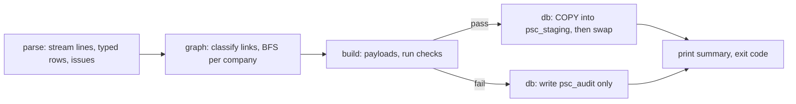

# Plan 02: Part 1 pipeline implementation

- Status: **Approved** (2026-11-14), with the simplifications below
- Coding style (user, 2026-11-14): **concise and functional, not fancy.** Plain functions and dataclasses, standard library plus psycopg, no frameworks, no abstraction layers, no configuration system.
- Builds: the data model in [plan 01](01-logical-data-model.md) (approved 2026-11-13), under ADRs [0001](../decisions/0001-traversal-bfs-in-python.md) to [0012](../decisions/0012-when-the-run-fails.md).
- Scope: Part 1 only. The Helm chart (Part 2) gets its own plan (03). This plan fixes only the interface the chart will call.
- Guiding rule: the brief is "not looking for feature count, polish, or a perfect solution". We build the smallest pipeline that is correct end to end, with tests on the logic that matters, and nothing else.

## Changes during the build (2026-11-14)

- The SQL lives in the package (`src/psc_pipeline/sql/audit.sql` and `schema.sql`), not in a top-level `sql/`, so the installed image can find it.
- Steps 6 and 7 both went into `build.py`, as planned. `data_quality` counts only warnings and errors (the user's decision).
- Bugs found and fixed while building are listed in each step report in the prompt log and session. The main ones: ISO week dates, non-ASCII digits, a second totals line, invalid birth months, duplicates not tied to a company, missing `levels`, and a crash when there is no snapshot date.
- Docker Desktop's engine wasn't running in the build session. The integration tests and the full-sample load were run against a throwaway Postgres 16 from the `pgserver` pip package, in a scratch venv. `docker compose` and the image build still need to be run once.
- Later on 2026-11-14 the image was built and run with Compose. Run 6 loaded the full sample (29,125 companies, every fail rule passed, exit 0). The user found the database holding test data: the integration tests had published their 3-company fixture into the same `psc` database. They now create and use their own `psc_test` database (override with `PSC_TEST_DATABASE_URL`).

## 1. What "done" looks like

From a clean clone:

```
docker compose up -d postgres
docker compose run --rm pipeline          # runs against data/*.gz and writes to Postgres
docker compose exec postgres psql -U psc -d psc \
  -c "SELECT jsonb_pretty(payload) FROM psc.psc_by_company WHERE company_number = '04555610'"
```

- The run ends with a short quality summary (ADR 0012) and exit code 0.
- Its counts agree with the [data profile](../specs/01-data-profile.md). The two were written separately, so each checks the other.
- `pytest` passes with no database. `pytest -m integration` passes against the Compose Postgres.

## 2. Repository layout (new files)

```
pyproject.toml                 package metadata; runtime dependency psycopg[binary] only; pytest as a dev extra
Dockerfile                     python:3.11-slim; installs the package; copies data/ read-only into the image
compose.yaml                   postgres:16 and pipeline services; the data/ directory mounted read-only
src/psc_pipeline/            six small modules
  __main__.py                  arguments, run the steps in order, exit code; `python -m psc_pipeline` (the chart already calls this)
  normalise.py                 company and registration numbers, the UK test, dates (ADRs 0005, 0008, 0009)
  parse.py                     stream the gzip, parse lines, trailer, duplicates, typed rows, active rule, PII trimming, issues (ADRs 0007, 0008, 0010, 0011)
  graph.py                     classify links, BFS (level, via, route_count), cycles, depth cap (ADRs 0001, 0003, 0009)
  build.py                     JSON payload for each company, the run checks and thresholds, the text summary (plan 01 section 4, ADR 0012)
  db.py                        run schema.sql, COPY into psc_staging, swap, write psc_audit (ADR 0002)
sql/schema.sql                 DDL for plan 01's tables
tests/
  fixtures/zz_example.jsonl    the worked example from plan 01, section 5 (hand-written)
  fixtures/real_cycle.jsonl    lines copied from data/ for 09090984 ⇄ 05104525
  fixtures/real_deep_chain.jsonl  lines copied from data/ for the 04555610 chain
  test_normalise.py, test_parse.py, test_graph.py, test_build.py
  integration/test_end_to_end.py
```

`data/` stays untouched. Test fixtures are copies of a few lines, made by a small extraction script that is kept in `scripts/`.

## 3. The pipeline interface (what the chart will call)

```
python -m psc_pipeline --input <path to .txt.gz or .txt> [--dry-run]
```

- **Connection:** the standard libpq variables (`PGHOST`, `PGPORT`, `PGUSER`, `PGPASSWORD`, `PGDATABASE`), or `DATABASE_URL`. psycopg reads them directly, so no extra settings code is needed. Passwords never go in arguments.
- **`--dry-run`:** all checks run and the report is printed, but nothing is written (the chart's `PSC_DRY_RUN` maps to this).
- **Thresholds** (ADR 0012) are constants at the top of `build.py`. Making them configurable is left for later.
- **Exit codes:**

| code | meaning |
|---|---|
| 0 | published (or a dry run passed) |
| 1 | a check failed, nothing published |
| 2 | any other error (bad input, database), with the traceback in the log |

## 4. How a run flows



- **One pass over the file.** Clean rows are kept in memory. That's fine for the sample (48k lines, about 60 MB in the profiler), and the production write-up explains how this changes at 16M records.
- **Two schemas:**
  - **`psc`** holds the clean tables, `company_ancestor` and `psc_by_company`. A run writes them into a staging schema, which replaces `psc` in one transaction (drop `psc`, rename `psc_staging` to `psc`) only if every check passes. Readers see either the old week or the new one, never a half-written mix.
  - **`psc_audit`** holds `pipeline_run` and `data_issue`. It's append-only and keeps every run, including failed ones, so "what did the checks find" can always be answered.
- **Loading** uses `COPY` (psycopg's `copy`), not row-by-row inserts.
- **Indexes:**
  - `psc_by_company`: the primary key only. That is the one lookup.
  - The clean tables: their primary keys, plus `psc(company_number)` and `data_issue(run_id, check_code)` for analysis.

## 5. Build order (each step is tested before the next one starts)

| # | Step | Tests that prove it |
|---|---|---|
| 1 | **Spec 02 (short):** the normalisation rules, the catalogue of issue codes, the expected payloads for the fixtures (as promised in plan 01, section 6) | review only |
| 2 | **Scaffold:** pyproject, package, pytest config, empty modules | `pytest` runs |
| 3 | `normalise.py` | Table-driven tests: `' 10333133'`, `9906121`, `oc330146`, `Sc19230 → SC019230`, `ZC202 → ZC000202`, `R0000134` accepted, `Zc` and empty values rejected. UK test: `United Kingdom (Scotland)`, `England And Wales`, `Delaware`, empty. Dates: timestamp truncated, invalid date. **Every accepted key passes the function unchanged** (ADR 0005). |
| 4 | `parse.py` | malformed line rejected and the kind recovered; trailer parsed and not counted as data; exact duplicate dropped; conflicting duplicate prefers the ceased copy; active rule (future `ceased_on` still active, future `notified_on` not active, `ceased_on` before `notified_on` treated as ceased); super-secure `ceased` flag; dropped PII fields are absent; **every drop, fix or flag produces an issue** |
| 5 | `graph.py` | each reason code (including `foreign_number_collision`, `jurisdiction_missing` and `self_ownership`); BFS levels on the ZZ example; diamond gives `route_count = 2`; cycle ends, and is logged once per cycle; self-loop; depth cap hit gives a warning |
| 6 | `build.py` (payload) | the ZZ example produces exactly the JSON in plan 01, section 5.5 (a golden file); legal persons go in `other_controllers`; statement-only and exempt status; null fields left out; the real deep chain gives 22 levels, with the top level's statement shown |
| 7 | `build.py` (checks and summary) | each fail rule in ADR 0012 at, just below and just above its threshold; a failed run produces no publish |
| 8 | `db.py` and `sql/schema.sql` | integration test: load the ZZ fixture, swap, look up `ZZ000001` = golden JSON; a failed run leaves the previous `psc` schema in place and still writes to `psc_audit` |
| 9 | `__main__.py`, `Dockerfile` and `compose.yaml` | full run on the sample through Compose; counts compared with the profile (section 6) |
| 10 | README "Running the solution" | the commands are run as written, from a clean clone |

## 6. How I'll check the output (beyond unit tests)

1. **Reconciliation against the profile:**
   - 47,674 distinct records;
   - 3 malformed lines;
   - 476 dropped duplicates;
   - 7,861 followed links, plus about 12 more from prefix padding;
   - 42 cycles;
   - a maximum depth of 22.

   Any difference has to be explained before we move on.
2. **Hand checks:** for three companies (a simple one, the cycle, and the deep chain), compare the payload line by line with the raw records (`zcat | grep`).
3. **Invariants**, checked by SQL queries in the integration test:
   - every company in `psc.company` has exactly one serving row;
   - every `ownership_link` that wasn't followed has a matching `data_issue` row;
   - every key in the serving table normalises to itself.
4. **AI output review:** every test's expected values come from the specs and the profile, not from running the code and copying what it printed.

## 7. Not in this plan

- An API, the reverse question, and incremental loading for next week. They're optional, and get one sentence each in `NOTES.md`.
- Chart changes (plan 03), and `NOTES.md` (written by the user).
- Performance work beyond COPY. The sample is small, and scale is covered in the production write-up.
- Configurable thresholds, structured logging, retries, or a separate Markdown report file. The summary is printed and the details are in `psc_audit`.

## Open questions

None blocking. Two defaults I'll use unless you say otherwise:
- The Docker image **contains the sample data**, so the chart can run without downloading anything. The chart's download step is reviewed in Part 2.
- There's no `lookup` command. The README uses `psql` for the lookup, which keeps the code smaller.
